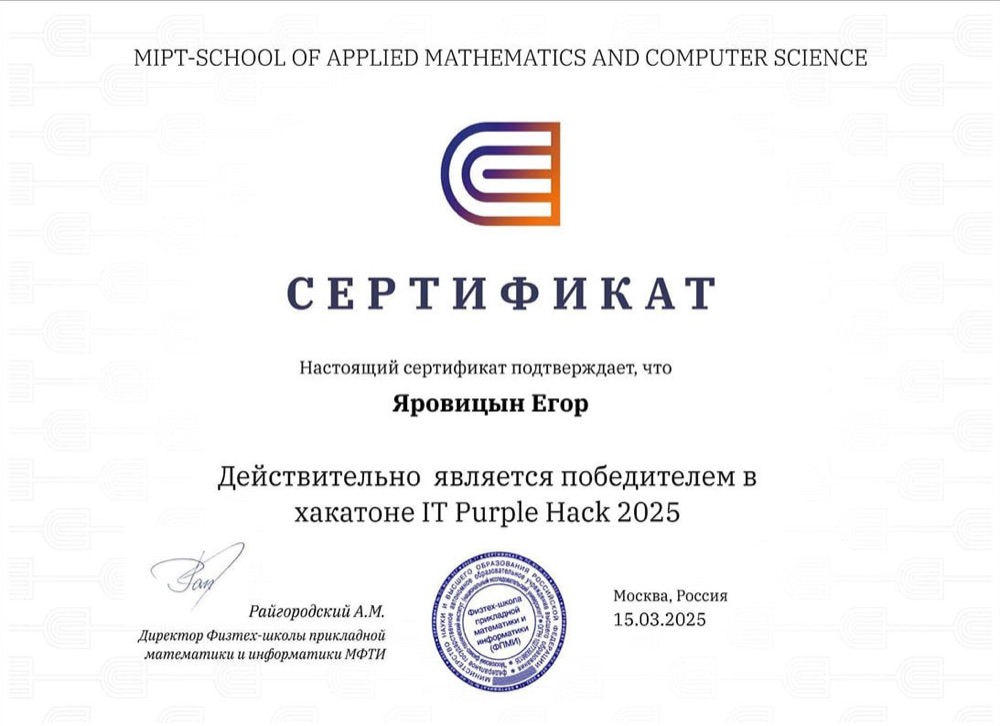
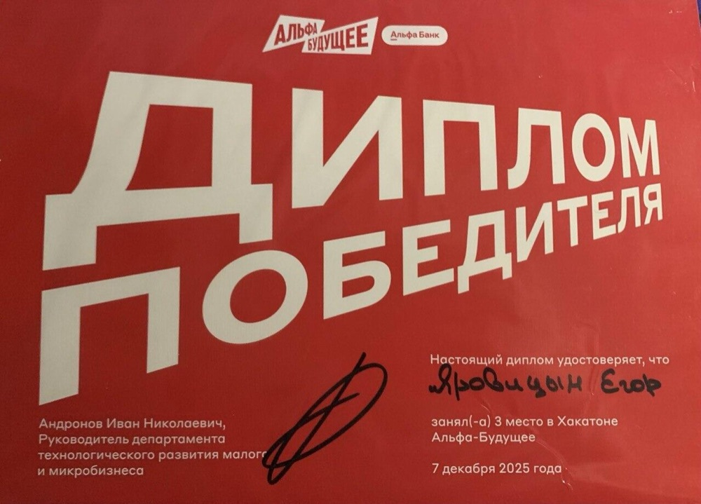
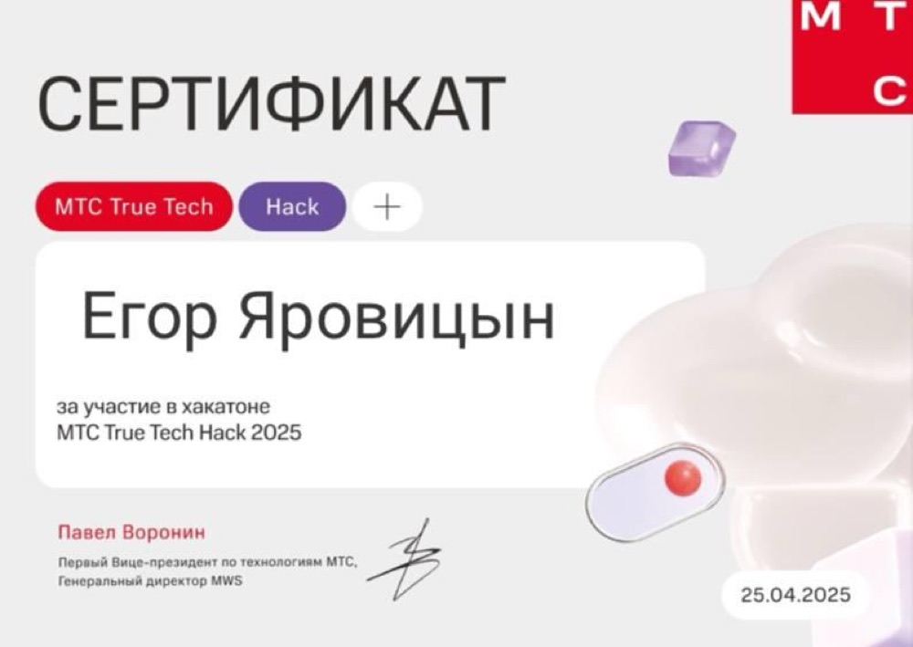
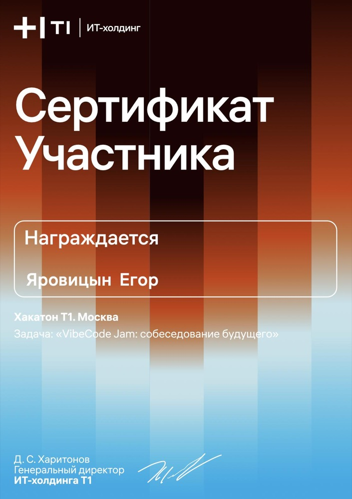
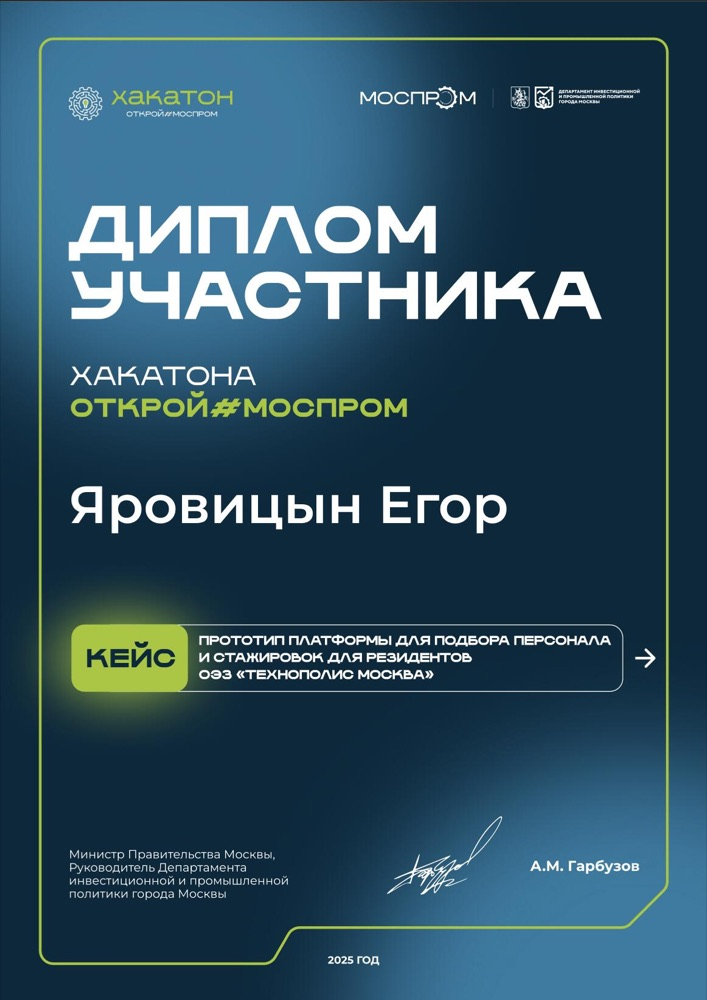
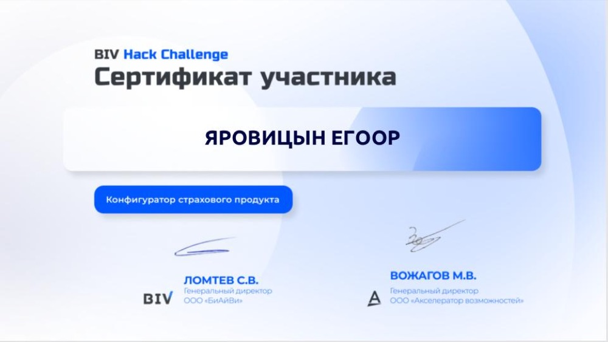

  

  
  

## About

Fullstack developer, 4 years of commercial development with React, Next.js and TypeScript, about two of them also with a Python / FastAPI backend. At Sovcombank I'm a lead frontend developer: the frontend of Tekhnologii Dobra, the bank's portal for 3,000+ non-profits from 79 regions (Next.js 15, SSR, ~42k lines of TypeScript), an internal CRM for curators, and the presentation-generation module of the bank's AI assistant, built end to end from FastAPI to React.

I work AI-first: Claude Code and Codex every day, my own MCP server for API contracts, AI code review in CI/CD. Agent output gets the same review as a colleague's: diff and tests.

## Impact

<table>
  <tr>
    <td align="center" width="25%"><h3>3,000+</h3>non-profits on the bank portal I build the frontend for</td>
    <td align="center" width="25%"><h3>350+</h3>tasks at Sovcombank · 3rd by commits among 20+ contributors</td>
    <td align="center" width="25%"><h3>20 → 12 s</h3>camera setup on a dashboard with ~100 live video streams</td>
    <td align="center" width="25%"><h3>500 → 900</h3>daily sessions in an online-school student account</td>
  </tr>
</table>

## What I've shipped

**Sovcombank** · Lead frontend developer · 2025 – now
- Portal and curators' CRM from design to release: multi-step forms, tables with server pagination, server prefetch with TanStack Query cache hydration, optimistic updates.
- My own TypeScript MCP server for backend API contracts: agents find the endpoint and get ready TS types; the whole team uses it.
- AI code review moved into a group-level CI/CD component that plugs in with one line; system prompts rewritten into a checklist of team standards.
- Co-designed a drag-and-drop kanban engine: the reducer is passed in from outside, so a new board needs no changes to the core.

**Appricot** · Fullstack developer · 2024 – 2025
- Video-surveillance dashboard with ~100 concurrent streams: grid virtualization and lazy player initialization.
- Gantt planner: API contracts reworked together with the backend, response time from ~500 to ~400 ms.
- Analytics for a developer with 11 residential complexes: FastAPI over ClickHouse, ~50 fields per project, many of them derived by the customer's formulas; replaced 20+ spreadsheet processes.

**Sirius Future** · Fullstack developer · 2022 – 2024
- Online school with 5,000+ students: subscriptions and recurring payments (T-Bank acquiring, Stripe, Apple Pay) with idempotent webhooks.
- Public pages on Next.js: organic traffic from 10k to 12.5k visits a month. Kids' games on PixiJS.

## Stack

  

| Area | Technologies |
| :-- | :-- |
| Frontend | TypeScript, React 19, Next.js 15 (App Router, SSR / ISR), TanStack Query, Redux Toolkit, MobX, Vite, Webpack / Module Federation, FSD, Playwright, Jest, Storybook |
| Backend | Python, FastAPI, PostgreSQL, ClickHouse, SQLAlchemy, Celery + Redis, pytest |
| Delivery | Docker, GitLab CI, Helm, Argo CD |
| AI | Claude Code, Codex, Claude Agent SDK, MCP |

## Selected repositories

| Repository | What it is | Stack |
| :-- | :-- | :-- |
| [payment-service](https://github.com/flavokrkkk/payment-service) | Take-home assignment: payments service with a transactional outbox, RabbitMQ retries and a dead-letter queue | Python, FastAPI, PostgreSQL, RabbitMQ |
| [sber-case](https://github.com/flavokrkkk/sber-case) | IT Purple Hack 2025, Sber case: project schedule optimization under time and resource constraints | TypeScript, NestJS, Next.js |
| [mts-vm-case](https://github.com/flavokrkkk/mts-vm-case) | IT Purple Hack 2025, MTS case: placing virtual machines on physical hosts round by round | TypeScript |
| [alpha_copilot_2025](https://github.com/flavokrkkk/alpha_copilot_2025) | Alfa-Future hackathon, 3rd place: AI copilot for micro-businesses. My part is the frontend with streamed answers (SSE); Go and Python services are the team's | React, Vite, TypeScript, TanStack Query |

## Hackathons

<table>
  <tr>
    <td align="center" width="33%"> <b>IT Purple Hack 2025</b> MIPT · winning team, I led three of five cases</td>
    <td align="center" width="33%"> <b>Alfa-Future 2025</b> Alfa-Bank · 3rd place, AI copilot for micro-businesses</td>
    <td align="center" width="33%"> <b>MTS True Tech Hack 2025</b> MTS · participant, AI case</td>
  </tr>
  <tr>
    <td align="center"> <b>T1 Hackathon, Moscow</b> T1 · participant, «VibeCode Jam: interview of the future»</td>
    <td align="center"> <b>Open#Mosprom 2025</b> Moscow Government · participant, hiring and internship platform for Technopolis Moscow residents</td>
    <td align="center"> <b>BIV Hack Challenge</b> BIV · participant, insurance product configurator</td>
  </tr>
</table>

## Talks

Speaker of three webinars on AI-assisted development: ~500, ~250 and ~150 attendees.

---

Telegram <a href="https://t.me/egoryaaa">@egoryaaa</a> · <a href="mailto:egoryarovitsyn1@gmail.com">egoryarovitsyn1@gmail.com</a>

